<div align="center">


<br/>

<a href="https://github.com/VijayLabKit"></a>
<a href="https://www.linkedin.com/in/vijay-ishan/"></a>
<a href="mailto:vijayishanchowdhury@gmail.com"></a>

<br/><br/>


</div>

<br/>


I find vulnerabilities, build security tools, and explore new attack surfaces.

My work covers offensive security, vulnerability assessment, web and network penetration testing, Active Directory security, and LLM application security. I like turning research into practical tools and environments that people can attack, understand, and fix.

<br/>


| `ID` | `DOMAIN` | `COVERAGE` |
|:-:|:--|:--|
| `01` | **Offensive Security** | VAPT · penetration testing · reconnaissance |
| `02` | **Web Security** | OWASP Top 10 · API security · authentication flaws |
| `03` | **Network Security** | Enumeration · service analysis · traffic inspection |
| `04` | **Active Directory** | Kerberos attacks · privilege escalation · domain security |
| `05` | **AI / LLM Security** | Prompt injection · RAG security · agent vulnerabilities |
| `06` | **Security Engineering** | Python automation · scanners · security utilities |

<br/>


**`LANGUAGES`**&ensp;


**`OFFENSIVE`**&ensp;


**`FRAMEWORKS`**&ensp;


<br/>


<table>
<tr>
<td width="50%" valign="top">

**`01` &nbsp;VulnScope Pro**<br/>
<sub>MODULAR VULNERABILITY ASSESSMENT & CVE INTELLIGENCE</sub>

Lightweight PHP + SQLite platform for asset discovery, web application assessment, and vulnerability intelligence.

- DNS, WHOIS and RDAP recon
- Port and service discovery
- Crawling and security checks
- CVE intel: NVD · CIRCL · EPSS · CISA KEV
- HTTP history, replay, authenticated scans

[**`→ SOURCE`**](https://github.com/ZeroDay-Security-Services/Vulnscope-Pro)

</td>
<td width="50%" valign="top">

**`02` &nbsp;OWASP LLM Learning Lab**<br/>
<sub>HANDS-ON LLM APPLICATION SECURITY RANGE</sub>

Community-built environment of intentionally vulnerable LLM applications with exploitation and remediation exercises.

- 22 labs across Beginner → Expert tiers
- Prompt injection, RAG poisoning, excessive agency, tool injection
- MCP security, agent authorization, memory poisoning
- Groq + Gemini with a deterministic simulator
- Fix-It sandbox with an independent LLM judge

[**`→ SOURCE`**](https://github.com/owaspsiliguri/Owasp_LLM_Lab)

</td>
</tr>
<tr>
<td width="50%" valign="top">

**`03` &nbsp;ZeroDay Academy**<br/>
<sub>PRACTICAL CYBERSECURITY LEARNING ENVIRONMENT</sub>

Hands-on cybersecurity learning built around practical labs, guided exercises, and technical training.

<br/>

[**`→ ZERODAY SECURITY SERVICES`**](https://github.com/ZeroDay-Security-Services)

</td>
<td width="50%" valign="top">

**`04` &nbsp;PromptPwn**<br/>
<sub>LLM RED TEAMING & AI SECURITY</sub>

AI security initiative for testing LLM-powered systems, exploring attack techniques, and understanding weaknesses in AI application workflows.

<br/>

[**`→ GITHUB PROFILE`**](https://github.com/VijayLabKit)

</td>
</tr>
</table>

<sub>The OWASP LLM Learning Lab is proposed by OWASP Siliguri and developed by the community. It is not an official OWASP project and has not been endorsed or accepted by OWASP.</sub>

<br/>


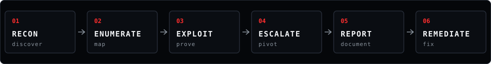

<br/>


```text
ORG        ZeroDay Security Services   founder & lead developer
CHAPTER    OWASP Siliguri              chapter leadership, community research
COMMUNITY  CyRaksha Siliguri           awareness, technical activity, North Bengal
```

[`ZERODAY SECURITY SERVICES`](https://github.com/ZeroDay-Security-Services)&ensp;
[`OWASP SILIGURI`](https://owasp.org/chapters/siliguri)&ensp;
[`CYRAKSHA SILIGURI`](https://instagram.com/cyrakshasiliguri)

<br/>


<div align="center">


</div>

<br/>


<div align="center">

<a href="https://www.linkedin.com/in/vijay-ishan/"></a>
<a href="https://github.com/VijayLabKit"></a>
<a href="https://medium.com/@zeroday-security-services"></a>
<a href="https://x.com/vijay_ishan_chowdhury"></a>
<a href="https://youtube.com/@ZeroDaySecurityServices"></a>
<a href="https://instagram.com/vijay_ishan_chowdhury"></a>

<br/><br/>

**Business & research inquiries** · [vijayishanchowdhury@gmail.com](mailto:vijayishanchowdhury@gmail.com)

<br/>


<sub>Practical security research, responsible disclosure, and tools that make systems harder to exploit.</sub>

</div>
